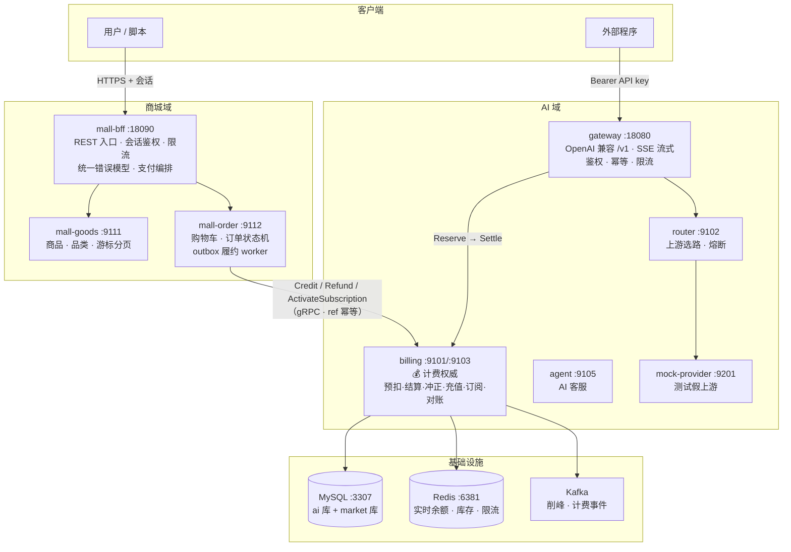
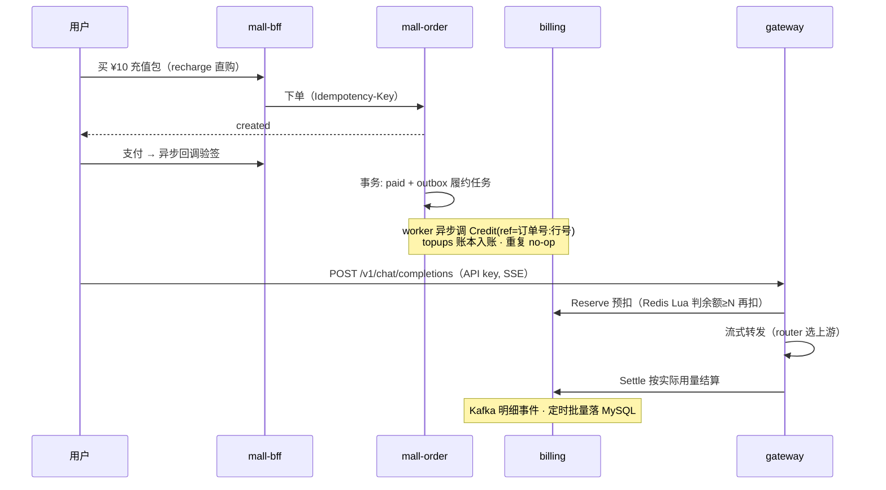

# my-market

<div align="center">

**一个「卖算力的商城」——Go 微服务商城 × AI 模型网关计费平台**

跑通完整商业闭环：**购买 → 入账 → 推理 → 计量 → 扣费**

[](../../actions) [](docs/spec/acceptance.md) [](scripts/) [](go.mod) []()

</div>

---

## 这是什么项目？

想象你在经营一家「算力商店」：

- 用户在商城里花 **¥10 买一个充值包**，余额立即到账；
- 用户拿 API Key 调用 **OpenAI 兼容接口**跑大模型，每百万 token 按模型单价从余额扣费；
- 或者按月订阅**月卡**，每个滚动窗口内推理免费，超额再按量计费；
- 也可以买手机、衣服——一条标准电商链路。

支撑这个生意的是 **11 个独立部署的微服务**：商城域（浏览/下单/支付/履约）+ AI 域（网关/计费/路由/客服），两个域只通过 gRPC 契约通信，账本由计费服务独占，其余任何服务碰不到钱。

> 项目由已完成的 [ai-gateway](docs/ai-gateway/README.md)（AI 模型网关计费平台）融合生长而来：计费内核（原子预扣/幂等结算/对账）一行未动，在其上新建商城域并以 [ADR-011](docs/spec/adr/ADR-011-服务拆分与编译器强制边界.md) 完成服务化拆分。

---

## 架构总览



**两张时序图看懂商业主线**（完整八图见 [architecture.md](docs/architecture.md)）：

**① 按量计费闭环**——买充值包到余额归零的完整旅程：



**② 月卡**——5 小时滚动窗口内免费、超额 402、退款=退订不退费（详见 [architecture.md §5](docs/architecture.md)）。

---

## 服务目录

| 服务 | 端口 | 职责 | 关键实现 |
|---|---|---|---|
| **mall-bff** | 18090 | 商城唯一 REST 入口 | 会话鉴权（经 gateway /auth 代理）、per-tenant Redis 限流、`{error,code,retryable}` 统一错误模型、PaymentProvider 支付编排（HMAC 验签回调） |
| **mall-goods** | 9111/9110 | 商品/品类 | 键集游标分页 `(created_at,id)`、多取一判 has_more |
| **mall-order** | 9112/9120 | 订单/购物车/履约 | 同库事务扣库存、幂等键 `(tenant,key)`、**outbox 履约**（支付事务内写任务→worker 异步调 billing→指数退避→promote 自愈）、30min 超时关闭回补 |
| **gateway** | 18080 | AI 推理数据面 | OpenAI 兼容 + SSE 流式中继、流式 usage 计数、幂等键、Redis Lua 限流 |
| **billing** | 9101/9103 | 💰 计费权威 | **Reserve/Settle/Reverse**（Lua 原子预扣·`uk_request_phase` 幂等·reconciler 对账）+ 五个加法 RPC（Credit/Refund/Activate/Cancel + 订阅窗口额度）；Redis 实时余额 + 批量落账；0 元锚订阅幂等 |
| **router** | 9102 | 上游选路 | 加权随机 + 熔断状态机（CLOSED/OPEN/HALF-OPEN）+ AutoBan 持久化 |
| **agent** | 9105 | AI 客服 | 意图路由（function calling）+ 写操作二次确认状态机 + 全量审计；执行层不信任 LLM |

**边界纪律**（[ADR-011](docs/spec/adr/ADR-011-服务拆分与编译器强制边界.md)）：billing 核心（server/lua/reconciler/consumer/outbox）在 `internal/` 后——**编译器保证** mall 永远 import 不到；`store/admin` 公开位由 [importguard](pkg/importguard) 白名单门禁看守（26 哨兵 + 831 文件扫描，恶意导入双向实证）。

---

## 快速开始

```bash
# 1. 环境变量（控制面令牌用 openssl rand 生成，见文件内注释）
cd deploy/compose && cp .env.example .env && $EDITOR .env

# 2. 一键起全家（MySQL 3307 / Redis 6381 / Kafka / 11 个服务容器）
docker compose --profile infra --profile ai --profile mall up -d

# 3. 端到端验证（可重复跑，随机租户零残留）
bash scripts/smoke-r2.sh     # 商业主线：充值→入账→推理扣费→断电演练→退款
bash scripts/smoke-r2.5.sh   # 月卡：混合单→窗口免费→超额402→退订
```

开发：

```bash
CGO_ENABLED=0 go build ./...          # 本机 SDK 兼容要求 CGO 关闭
go test ./services/mall-goods/... ...  # mall 域全绿
bash tools/verify/ci-gotest-baseline.sh tools/verify/ci-baseline-ai-gateway.txt
                                       # AI 域：失败名基线棘轮（81 条已知失败只减不增）
```

---

## 工程方法：规格驱动开发（SDD）

本项目全程按 **PRD → 规格五件套 → 任务计划 → 子代理实现+独立审查+修复循环 → 整分支终审 → 合并** 的流水线交付，每个里程碑的完整裁定与审查记录归档于 [docs/plans/sdd-archive-*/](docs/plans/)。CI 拒绝基线外新增失败（诚实棘轮）、Windows runner 校验冻结证据跨平台字节保真——**测试口径本身就是文档化的架构决策**。

## 测试与 CI

| CI Job | 验证什么 |
|---|---|
| mall | 根模块全量测试（真实 MySQL/Redis 服务容器 + schema/种子注入） |
| ai-gateway | AI 域测试 + **失败名基线棘轮**（81 条历史已知失败精确复现、0 新增才绿）+ Unix 脚本套件 |
| offline-evaluation (Windows) | 七个冻结证据校验器——跨平台**字节保真**验证 |
| web | 前端契约回归（vue-tsc + vite build + 冒烟 + 数据回归） |

## 路线图

- ✅ **R0** ai-gateway 整仓迁移（17k 文件零密钥）· **R1** 商城垂直切片 · **R2** 充值闭环（Credit/Refund + 断电不重不漏实证）· **R2.5** 月卡（退订语义）· **R2.6** 结构统一 + eval 顶层资产 · **R2.7** 服务拆分（编译器边界 + 白名单门禁双向实证）
- 🔜 **R3** K8s 化（k3s 双机、多副本、HPA 压测扩容、Prometheus/Grafana/Jaeger）· **R6** Web 双前端（Vue3 用户端 + 管理端，mall-bff 托管）
- 🔜 **R4** 秒杀（Redis Lua 扣减 + Kafka 削峰 + 对账）+ 带数字的压测报告

## 文档地图

| 想了解 | 去哪 |
|---|---|
| 服务流转八图（时序） | [docs/architecture.md](docs/architecture.md) |
| 产品需求与全部决策（D1-D19） | [docs/PRD.md](docs/PRD.md) |
| REST 契约 + 27 错误码全表 | [docs/spec/api-contract.md](docs/spec/api-contract.md) |
| 数据库 DDL（9 表） | [docs/spec/db-schema.sql](docs/spec/db-schema.sql) |
| 架构决策记录（11 篇 ADR） | [docs/spec/adr/](docs/spec/adr/) |
| 各里程碑审查台账 | [docs/plans/sdd-archive-*/](docs/plans/) |
| 评测资产规约 | [eval/README.md](eval/README.md) |

---

<div align="center">

 Built with spec-driven development · every decision traceable to an ADR

</div>
