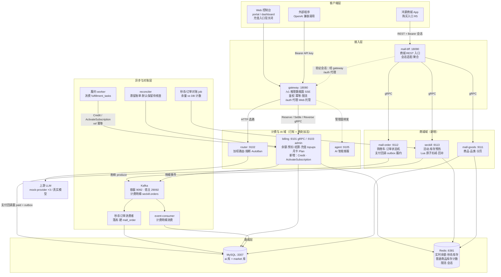
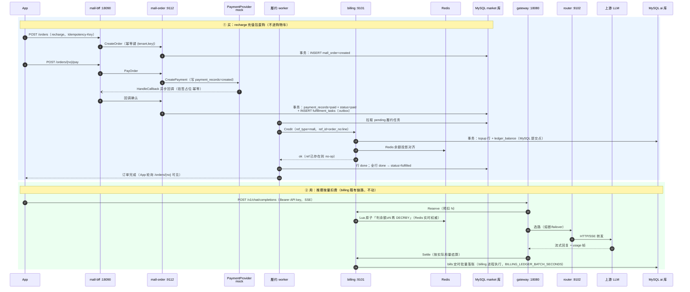
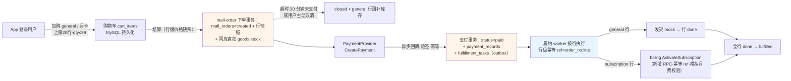
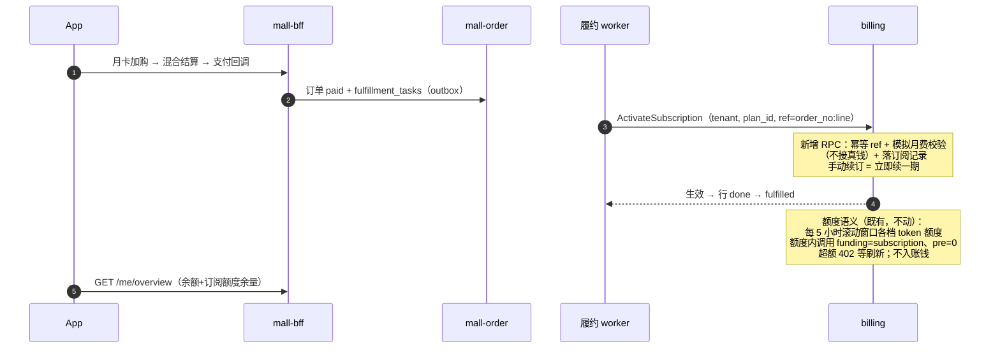
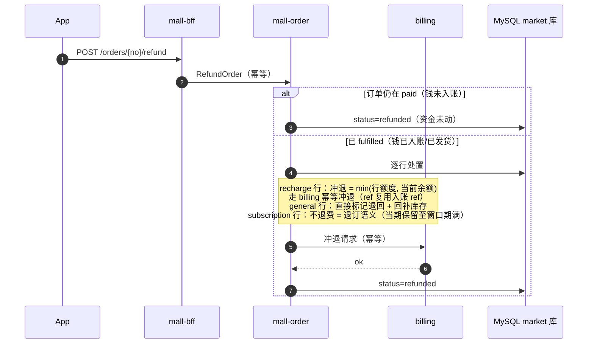
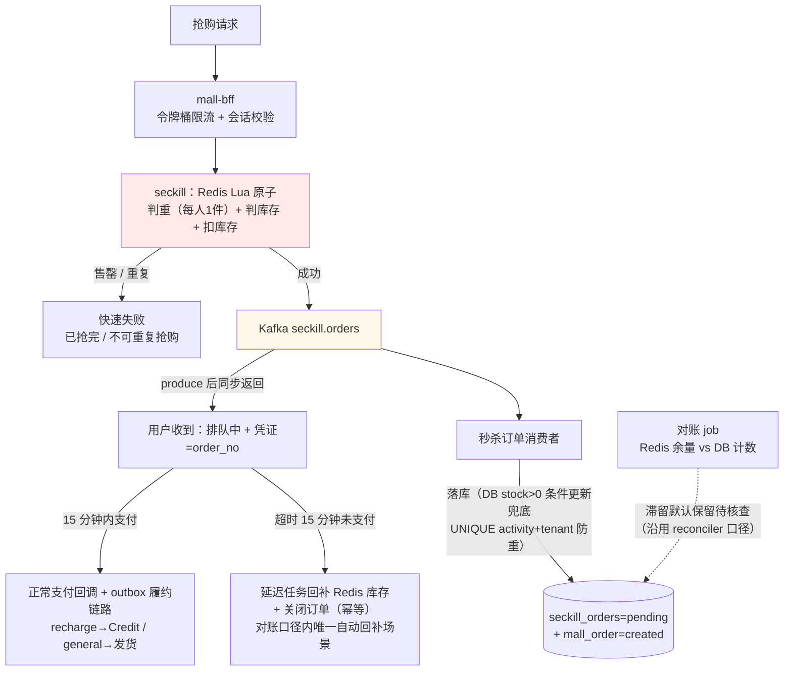
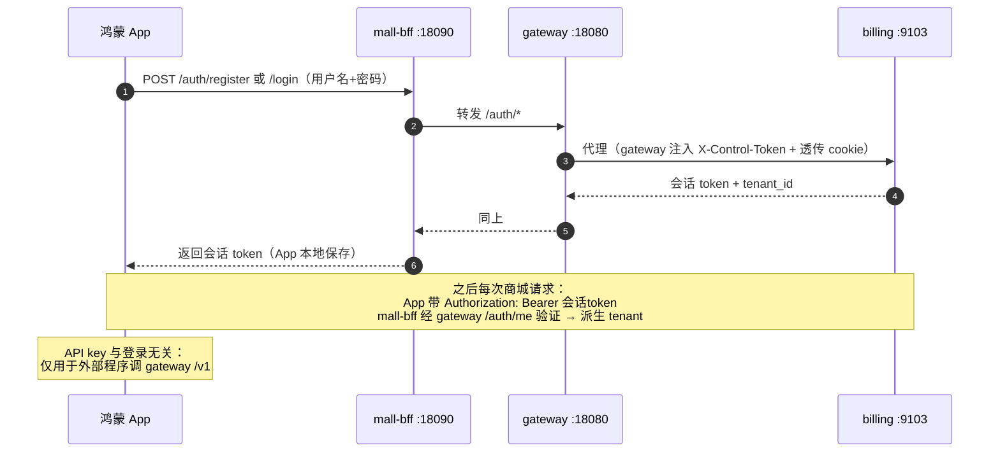
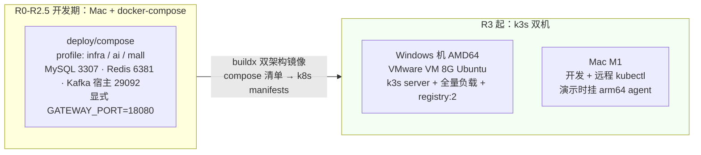

# my-market 架构与服务流转图

> 配套 [PRD.md](PRD.md) v0.3 使用。图为规格与实现的统一依据，变更先改图再改码。
> 以下 Mermaid 图可在 GitHub / VS Code / Typora 直接渲染。

---

## 1. 全景架构（分层）

**读图要点**：
- 对外只有两个数据面入口：mall-bff（商城）与 gateway（推理 + Web + /auth 代理）；
- 一切「给用户加钱」的动作收敛到 billing 的新增 `Credit`（ref 幂等）；
- 写路径分层：推理 bills = Redis 实时权威 + 批量落账（已有不动）；充值 topups = 同步 MySQL 事务（已有不动）；mall_order = 支付同步事务 + outbox 履约（新）；seckill = Kafka 异步落库（新）。

---

## 2. 服务清单与端口（dev，已按代码核实）

| 服务 | 端口 | 协议 | 状态 |
|---|---|---|---|
| gateway | **18080（代码默认 8080，compose 须显式 GATEWAY_PORT）** | HTTP/SSE | 已有 |
| billing | 9101 gRPC · 9103 admin（全端口 X-Control-Token） | gRPC / HTTP | 已有（+Credit、+ActivateSubscription） |
| router | 9102 | HTTP | 已有 |
| agent | 9105 | HTTP | 已有 |
| mock-provider | 9201-9203 | HTTP/SSE | 已有 |
| mall-bff | 18090 | HTTP（REST） | 新增 |
| mall-goods | 9111 | gRPC | 新增 |
| mall-order | 9112 | gRPC | 新增 |
| seckill | 9113 | gRPC | 新增 |
| MySQL | 3307 | — | 已有（+market 库） |
| Redis | 6381 | — | 已有 |
| Kafka | **容器 9092 / 宿主 29092** | — | 已有（+新 topic，Producer 单 topic 需新实例） |
| registry | 5000 | — | R3 K8s 期 |

---

## 3. 服务流转一：充值闭环（商业主线：回调驱动 + outbox 履约）

---

## 4. 服务流转二：混合购物车订单（general + 月卡，outbox 履约）

规则：recharge 充值包**不走此链路**（仅直购，见流转一）；秒杀商品也不走（见流转五）。

---

## 5. 服务流转三：月卡生效（额度窗口语义为 billing 既有；开通接口为新增）

---

## 6. 服务流转四：退款（D15 裁定）

---

## 7. 服务流转五：秒杀（充值包 + 普通商品）

---

## 8. 服务流转六：App 会话与鉴权（billing 零改动，经 gateway 代理）

---

## 9. 部署演进

K8s 验收七项（不再加戏）：多副本+反亲和 · HPA · 滚动更新 · 探针 · Prometheus/Grafana/Jaeger · Ingress · 节点 drain 自愈。

---

## 10. 图-文档映射

| 图 | 详细规格落点 |
|---|---|
| §1 全景架构 | PRD §3-§4 |
| §3 充值闭环（含回调+outbox） | spec/sequences.md#充值闭环（含错误分支） |
| §4 混合订单 | spec/sequences.md#混合订单 · spec/db-schema.sql |
| §5 月卡生效 | spec/sequences.md#月卡 |
| §6 退款 | spec/sequences.md#退款 |
| §7 秒杀 | spec/sequences.md#秒杀（含对账） |
| §8 会话鉴权 | spec/api-contract.md#鉴权 |
| §9 部署演进 | deploy/compose · deploy/k8s |
