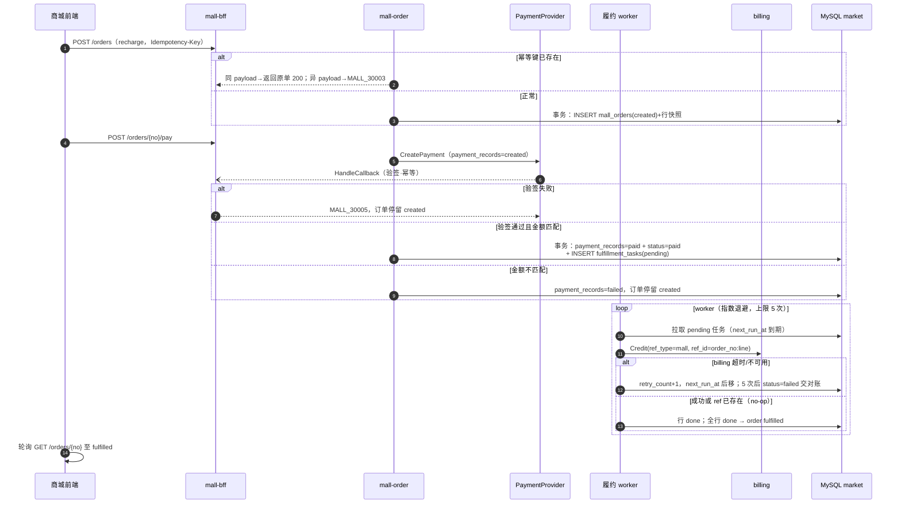
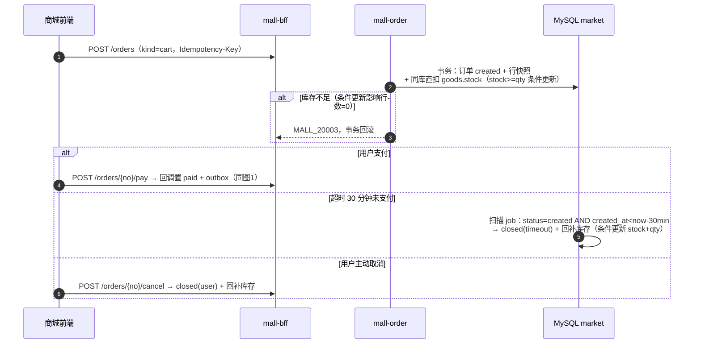
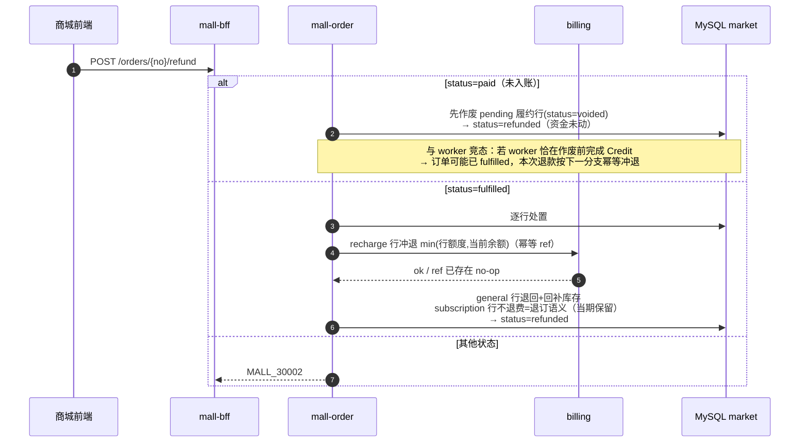
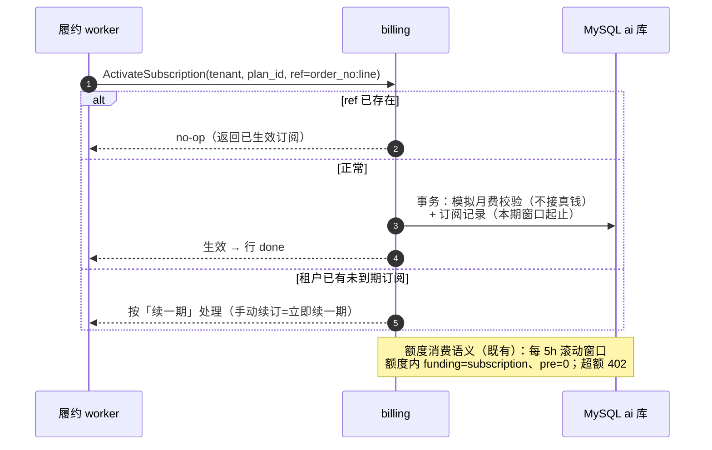
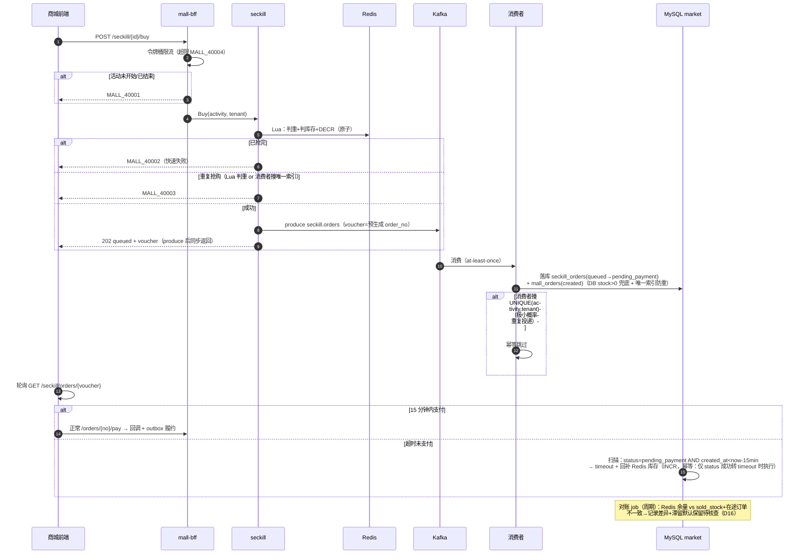
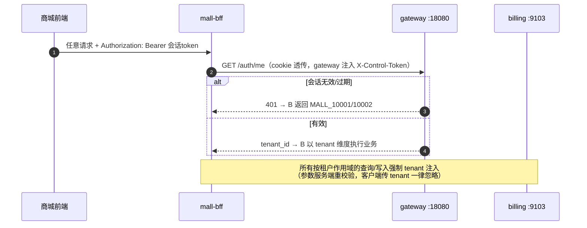

# 核心时序（spec/sequences.md）

> 依据 PRD v0.5 + architecture.md 八图；本文件补**错误分支**，为实现与验收的依据。图为 Mermaid，可渲染。
> 调用方说明（2026-11-18）：鸿蒙作业已取消，图中 App/调用方 = **商城 Web 前端**（用户端 mall-user；管理端走 /admin/*，R6 契约增补）——见 PRD §5.4/D18。

---

## 1. 充值直购闭环（含错误分支）

**断电恢复推演**：paid 已落库但 outbox 行未执行 → worker 重启后按 `idx_status_next` 继续拉取；Credit 幂等（uk_ref）保证重试不重复入账；行 failed → 对账 job 标记人工处置。

---

## 2. 混合购物车订单（含超时/取消）

---

## 3. 退款（D15，含竞态）

---

## 4. 月卡开通（R2.5）

---

## 5. 秒杀（含全部失败分支与对账）

---

## 6. 会话与越权防护

---

## 7. 错误→HTTP 映射（实现备忘）

| gRPC/内部错误 | HTTP | code |
|---|---|---|
| 会话 401（gateway 转发） | 401 | MALL_10001/10002 |
| billing Unavailable/Deadline | 503/504 | MALL_50003/50002（retryable） |
| goods 记录不存在 | 404 | MALL_20001 |
| 条件更新影响行数=0 | 409 | MALL_20003 / MALL_30002（按场景） |
| 唯一索引冲突（idem/秒杀防重） | 409 | MALL_30003 / MALL_40003 |
| 参数校验失败 | 400 | MALL_10005 |
